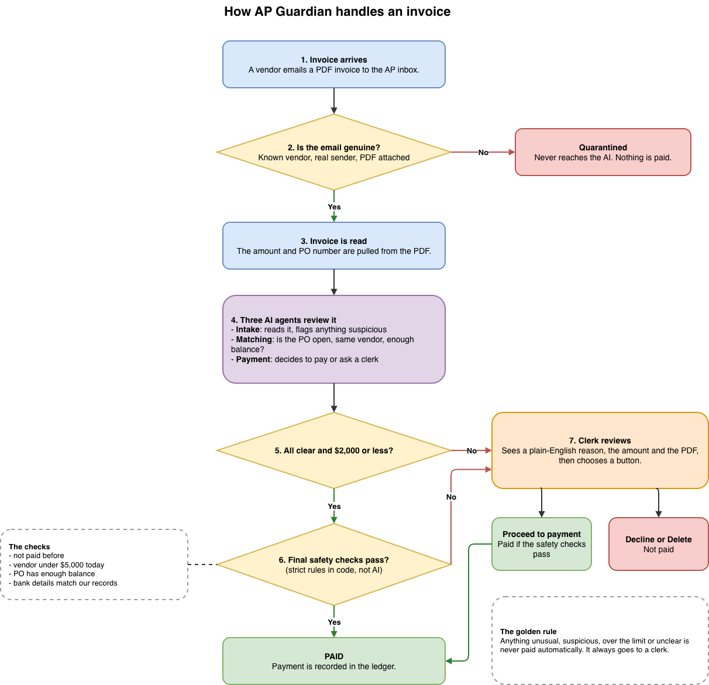
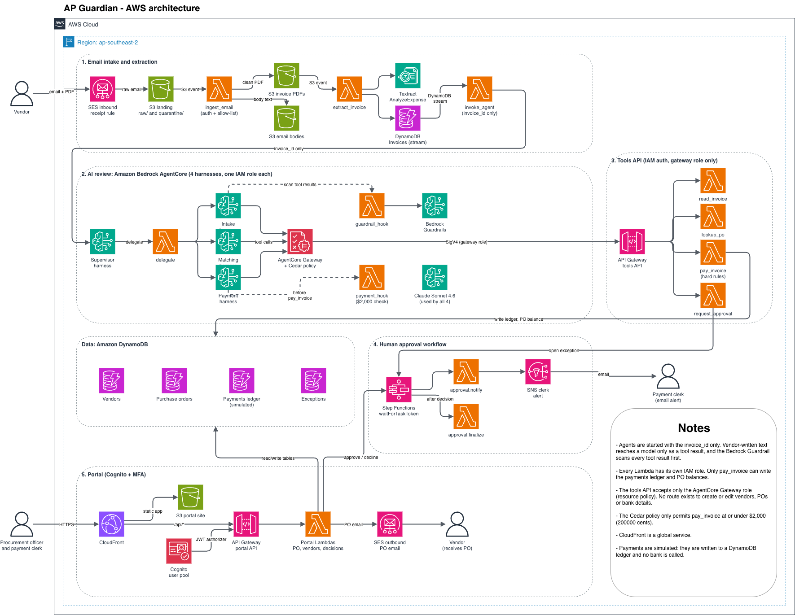
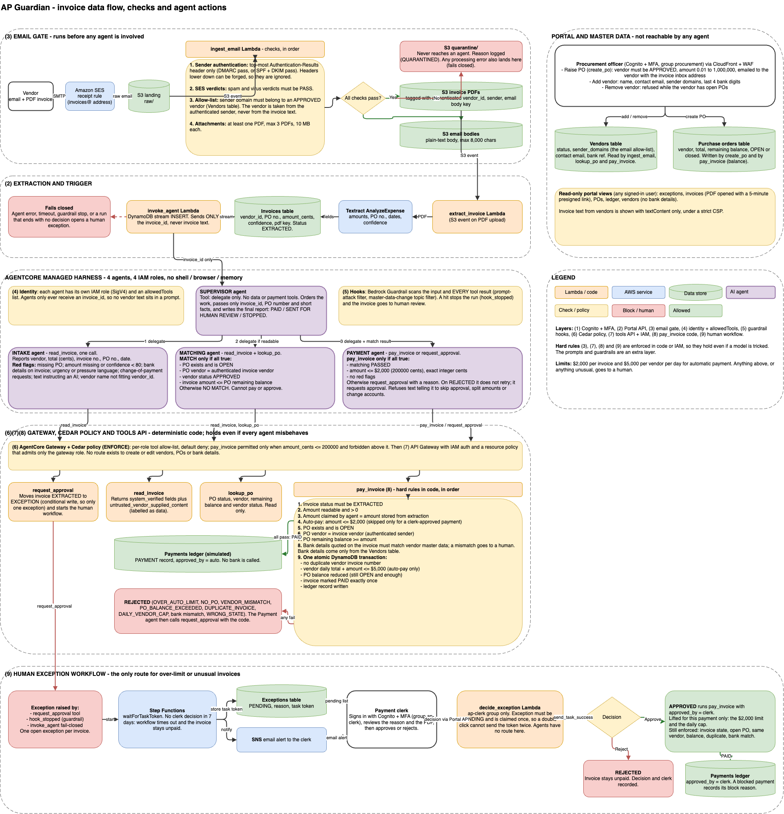

# AP Guardian: an accounts payable agent that stays inside its limits

AP Guardian reads vendor invoices from email, matches them to purchase orders,
and pays the clearly legitimate ones automatically. A human only has to sign in
when something is out of range. It runs as four agents on the
**Amazon Bedrock AgentCore managed harness**. They are boxed in by nine
enforcement layers, so a prompt injection hidden in an invoice can't move money.

- **Step-by-step deployment and operations guide:** [`docs/DEPLOYMENT.md`](docs/DEPLOYMENT.md)
- **Rules (plain language) and the enforcement map:** [`docs/RULES.md`](docs/RULES.md)
- **Adversarial test plan:** [`docs/STRESS_TESTS.md`](docs/STRESS_TESTS.md). Results from a real run are written to `docs/stress_results.md`.
- **Diagrams:** see [Diagrams](#diagrams). Editable draw.io sources are in `docs/`.

## Diagrams

**Simple flow.** The seven steps an invoice goes through, in plain language.



**AWS architecture.** The services and how they connect.



**Detailed data flow.** Every check, every agent and what each one is allowed to do.



Editable sources: [`docs/data-flow-simple.drawio`](docs/data-flow-simple.drawio),
[`docs/architecture.drawio`](docs/architecture.drawio) and
[`docs/data-flow.drawio`](docs/data-flow.drawio). Open them at
[app.diagrams.net](https://app.diagrams.net) or with the draw.io editor extension.

## What the portal does

| Tab | Who | What |
|---|---|---|
| Exceptions | `ap-clerk` | Review invoices that need a human. Each item shows a plain-English reason, the amount and the PO. Buttons: **Proceed to payment**, **Decline**, **Delete**. Others can view the queue. |
| Invoices | any signed-in user | List and open the PDF (5-minute link) |
| Purchase orders | `procurement` | Raise a PO for an approved vendor. The vendor is emailed the PO (needs `po_from_address`). |
| Vendors | `procurement` | Add and remove vendors (name, contact email, sender domains, last 4 bank digits). Removal is refused while the vendor has open POs. |
| Payments ledger | any signed-in user | Simulated payments |

> Payments are **simulated**: they are written to a DynamoDB ledger and no bank
> is called. To connect a real payment rail, replace the ledger write in
> `lambdas/common.py`.

## Architecture

```
Vendor ──email──▶ SES ─▶ S3 landing ─▶ ③ ingest_email ──(clean body)──▶ S3 email bodies
                                        │ SPF/DKIM/DMARC + allow-list
                                        │ else ─▶ quarantine/
                                        └──(PDF, tagged with authenticated vendor)──▶ S3 invoice PDFs
                                                                                       │ S3 event
                                                                       extract_invoice ─▶ Textract AnalyzeExpense
                                                                                       │
                                                                     Invoices table (fields + pdf_s3_key)
                                                                                       │ stream (INSERT)
                                                                                 invoke_agent  (sends ONLY the invoice id)
                                                                                       │
 ┌──────────────── Bedrock AgentCore harness (4 harnesses, 4 IAM roles) ──────────────────────────────┐
 │ ④ Identity: SigV4 per role   ⑤ hooks: Guardrail on input + every tool result, payment limit check │
 │ Supervisor ─delegate─▶ Intake (read_invoice) · Matching (read_invoice, lookup_po) · Payment        │
 │ ⑥ AgentCore Gateway + Policy (Cedar): per-role tool allow-list, pay only ≤ 200000 cents            │
 └──────────────────────────────────────────────────┬──────────────────────────────────────────────────┘
                                                    │ SigV4 (gateway role only)
                          ⑦ Agent Tools API (API Gateway, IAM auth, resource policy)
                     read_invoice · lookup_po · ⑧ pay_invoice (hard rules) · request_approval
                                                    │                              │
                         Shared data: POs & vendors, Invoices, Payments ledger     ▼
                                                                ⑨ Step Functions (waitForTaskToken) ─▶ SNS ─▶ clerk
 Procurement officer / Payment clerk ─▶ ① Cognito (MFA) ─▶ CloudFront (+WAF) ─▶ S3 SPA
                                                            └─/api/*─▶ ② Portal API (Cognito authorizer)
                                     create_po (procurement) · decide_exception (ap-clerk) · read-only views
                                     get_invoice ─▶ 5-minute presigned link to the PDF
```

Design choices that matter for the boundaries:

- **Untrusted text never sits in the prompt.** The agents are started with an invoice ID only. Vendor-written content reaches a model only as a tool result, labelled `untrusted_vendor_supplied_content`, and an `after_tool_call` hook runs Bedrock Guardrails over every tool result before the model sees it.
- **Deterministic work is outside the agents.** Raising POs, approving exceptions, extraction and email checks are plain Lambdas behind Cognito or IAM. Agents can read POs but never create them, so a forged invoice can't create the PO it needs.
- **The vendor comes from the authenticated sender**, not from anything printed on the invoice. Bank details come only from vendor master data.
- **It fails closed.** Errors, timeouts, guardrail stops and runs that end without a decision all become human exceptions.

## Repository layout

```
infra/stack.py          CDK: S3, DynamoDB, Cognito, CloudFront+WAF, 2× API Gateway, SES, Step Functions,
                        Bedrock Guardrail, Lambdas, IAM roles (one per harness, one per tool)
lambdas/                ingest_email, extract_invoice, invoke_agent, delegate, tools_api, approval,
                        portal_api, hooks, common (payment core)
agentcore/provision.py  Creates the policy engine, gateway, targets, Cedar policies and 4 harnesses
agentcore/policies/     Cedar policies (templated with gateway ARN / role names)
agentcore/prompts/      System prompt per agent
portal/                 Static SPA (vanilla JS, Cognito Hosted UI + PKCE)
scripts/                deploy.sh, destroy.sh, package.sh, seed_data.py, stress_test.py, testkit.py
tests/test_rules.py     Offline tests (moto + cedarpy) for the payment rules, email gate, hooks and Cedar policies
docs/                   DEPLOYMENT.md, RULES.md, STRESS_TESTS.md, diagrams (.drawio sources and .png exports)
```

Run the offline tests before you deploy: `pip install pytest "moto[dynamodb,stepfunctions]" pypdf cedarpy && pytest -q tests/`

## Deploy

### 1. Prerequisites

- An AWS account and an IAM principal that can create IAM roles, Lambda, S3, DynamoDB, Cognito, CloudFront, WAF, API Gateway, Step Functions, SES, Bedrock and AgentCore resources.
- Region: any region that offers Bedrock AgentCore harnesses, Textract and (for real inbound email) SES email receiving. It has been run in **ap-southeast-2**. The CloudFront WAF is only created in **us-east-1**. Set `AWS_REGION` and `CDK_DEFAULT_REGION` to the same region for every command.
- **Model access:** if you leave `MODEL_ID` empty, the harness uses its managed recommended model. To pin one, set `MODEL_ID` to a Bedrock model or inference profile ID you have access to, for example `us.anthropic.claude-sonnet-4-6`.
- Local tools: AWS CLI v2 (configured), Node.js 20+, the CDK CLI (`npm install -g aws-cdk`), and Python 3.12+.

### 2. Configure (optional)

Edit `cdk.json`, or pass `-c key=value` to the deploy script:

| Context key | Purpose | Default |
|---|---|---|
| `prefix` | Resource name prefix. It also appears in the Cedar role matching. | `apguardian` |
| `cognito_domain_prefix` | Hosted UI domain prefix. Must be globally unique. | `apguardian-<account>` |
| `clerk_email` | SNS email subscription for exception alerts | none |
| `inbox_address` | Address that receives invoices, e.g. `invoices@ap.yourdomain.com` (enables the SES receipt rule) | none, so use the test path |
| `po_from_address` | Verified SES sender for outbound PO emails | none, so POs are created but not emailed |

### 3. Deploy everything

```bash
export AWS_REGION=us-east-1          # or the region you use, e.g. ap-southeast-2
# optional: pin the model, e.g. us.anthropic.claude-sonnet-4-6 or au.anthropic.claude-sonnet-4-6
# export MODEL_ID=...
./scripts/deploy.sh -c clerk_email=you@example.com
```

Settings passed with `-c` replace the values in `cdk.json` on each deploy. Put your
`inbox_address`, `po_from_address` and `clerk_email` in `cdk.json` so a later deploy
does not blank them. The full guide, including updating an existing deployment, is in
[`docs/DEPLOYMENT.md`](docs/DEPLOYMENT.md).

The script will:

1. Build a Lambda layer with a current boto3, which includes the harness APIs.
2. Run `cdk bootstrap` and `cdk deploy`. Outputs go to `cdk-outputs.json`.
3. Run `agentcore/provision.py`. This creates the Cedar policy engine, the gateway (IAM inbound, policy **ENFORCE**), the API Gateway and Lambda targets, the six Cedar policies and the four harnesses with hooks. It also stores the harness ARNs in SSM.
4. Run `scripts/seed_data.py`, which adds two approved vendors, one suspended vendor and three seed POs.

Confirm the SNS subscription email if you set `clerk_email`.

### 4. Create portal users

```bash
POOL=$(python -c "import json;print(json.load(open('cdk-outputs.json'))['ApGuardianStack']['UserPoolId'])")
aws cognito-idp admin-create-user --user-pool-id $POOL --username buyer@example.com \
  --user-attributes Name=email,Value=buyer@example.com Name=email_verified,Value=true
aws cognito-idp admin-add-user-to-group --user-pool-id $POOL --username buyer@example.com --group-name procurement

aws cognito-idp admin-create-user --user-pool-id $POOL --username clerk@example.com \
  --user-attributes Name=email,Value=clerk@example.com Name=email_verified,Value=true
aws cognito-idp admin-add-user-to-group --user-pool-id $POOL --username clerk@example.com --group-name ap-clerk
```

Open the `PortalUrl` output and sign in. Cognito emails each user a temporary
password, then asks them to set a new one and enrol a TOTP authenticator, which
is required.

### 5. Run the stress tests

```bash
. .venv/bin/activate
python scripts/seed_data.py --reset      # clean PO balances, daily caps and test invoices
python scripts/stress_test.py            # ~5-15 minutes; writes docs/stress_results.md
```

The tests drop `.eml` files into the landing bucket, the same place SES writes
real mail. No domain is needed. In the portal, the clerk will see the
exceptions. Approve T3 to watch an over-limit payment go through the human
path.

### 6. (Optional) Real inbound and outbound email

1. In SES, verify a domain you control, such as `ap.yourdomain.com`, and add an MX record pointing to `inbound-smtp.<region>.amazonaws.com`.
2. Redeploy with `-c inbox_address=invoices@ap.yourdomain.com`, then activate the rule set. The command is printed as the `ActivateRuleSetCommand` output:
   `aws ses set-active-receipt-rule-set --rule-set-name apguardian-inbound`
3. For PO emails, verify the sender (`-c po_from_address=procurement@yourdomain.com`). While SES is in sandbox mode, also verify each vendor recipient address.
4. Update vendor `sender_domains` and `contact_email` in the Vendors table to match real vendors.

### 7. Watch it work

- **AgentCore console → Harnesses → Observability:** traces of each agent turn, tool call and hook decision.
- **CloudWatch logs:** each Lambda logs structured events such as `QUARANTINED`, `GUARDRAIL_DENY`, `PAYMENT` and `EXCEPTION_FINALIZED`.
- **Gateway policy decisions:** set the gateway's log delivery in the AgentCore console to see Cedar allow and deny per tool call.

## Troubleshooting

| Symptom | Likely cause and fix |
|---|---|
| `provision.py` says boto3 is too old | `pip install -U boto3` inside `.venv` |
| Every `pay_invoice` is denied by the gateway, even small ones | The Cedar condition reads `context.input.amount_cents`. If your gateway passes API Gateway request bodies under a different key, re-run `python agentcore/provision.py --policy-mode LOG_ONLY`, send one invoice, check the policy decision log for the actual input shape, and adjust `05_*.cedar` and `06_*.cedar`. Then switch back to ENFORCE. |
| A Cedar policy fails strict validation | `provision.py` retries with `IGNORE_ALL_FINDINGS` and prints the finding. Review it before production. |
| Harness errors with access denied on the model | Enable model access in Bedrock, or set `MODEL_ID` to a model or inference profile you can use, and re-run `provision.py` |
| Invoice never extracted | Synchronous `AnalyzeExpense` handles single-page PDFs. For multi-page invoices, switch `extract_invoice` to `StartExpenseAnalysis` |
| A harness finds no tools, or the supervisor writes `ask_intake_agent(...)` as plain text and stops ("Agents did not complete processing") | `allowedTools` must use the harness form `@ap_tools/<target>___<tool>`, for example `@ap_tools/agent-tools___read_invoice`. `provision.py` now does this. Re-run it after pulling the change. |
| `InvokeHarness` is denied for `bedrock-agentcore:InvokeAgentRuntime` | The invoke and delegate Lambda roles need both `InvokeHarness` and `InvokeAgentRuntime` on `harness/*`. `infra/stack.py` grants both. Redeploy the stack. |
| Invoice amount is blank or "(not read from PDF)" | Textract returned a value like `A$1,000,000.00`. `extract_invoice` now strips currency prefixes. If a PDF has no TOTAL or AMOUNT_DUE field, the amount stays empty and the invoice goes to a clerk. |
| PO email says "email not sent" | Read the reason shown after "email not sent". Usually `po_from_address` is empty in `cdk.json`, the sender or vendor address is not verified in SES in the stack's region (sandbox mode), or the vendor has no contact email. |
| No inbound email arrives | The MX record must point to `inbound-smtp.<stack-region>.amazonaws.com`, `inbox_address` must be set when deploying, and the rule set must be active (`aws ses set-active-receipt-rule-set --rule-set-name <prefix>-inbound`). |
| `AWS::SES::ReceiptRuleSet ... already exists` on deploy | A leftover rule set from an earlier deploy. Deactivate it with `aws ses set-active-receipt-rule-set`, delete it with `aws ses delete-receipt-rule-set --rule-set-name <prefix>-inbound`, then redeploy. |
| Clerk buttons are missing | The user must be in the `ap-clerk` group and must sign in again after being added. |
| Legitimate invoices go to review because of guardrail hits | Tune the denied-topic definitions in `infra/stack.py`, or lower the prompt-attack strength. Record it in the build log. |

## Clean up

```bash
./scripts/destroy.sh     # deletes harnesses, gateway, policies, then the CDK stack (all data is deleted)
```

## Build log and what broke

Fill this in from your own runs, using `docs/stress_results.md`. Judges reward
honest write-ups. These are the places most likely to break, and the fixes
already built in:

- **Split invoices (T4).** A per-invoice limit alone lets $5,700 through as three $1,900 invoices. The fix is a per-vendor daily total, updated atomically in the same DynamoDB transaction as the payment, so parallel invoices can't race past it.
- **Forged authentication header (T6b).** A naive parser that searches every `Authentication-Results` header accepts a "pass" planted by the sender. The fix is to trust only the top-most header, which SES adds.
- **Social engineering under the limit (T7).** This is the only rule held mainly by the prompt plus a guardrail topic. If it fails in your run, the honest fix is a hard rule: for example, have `ingest_email` flag urgency phrases into a `risk_flags` field that `pay_invoice` refuses to auto-pay.
- **Double exceptions.** `request_approval` and the fail-closed path in `invoke_agent` could both open a review. The fix is a conditional state change on the invoice (`EXTRACTED → EXCEPTION`) before the workflow starts.

## Security notes

- `InvokeHarness` accepts per-call overrides for tools and prompts. Only the `invoke_agent` and `delegate` Lambda roles hold `bedrock-agentcore:InvokeHarness`.
- The tools API resource policy denies every principal except the gateway role. Each tool Lambda has its own IAM role, and only `pay_invoice` can write the ledger.
- Portal output renders untrusted invoice text with `textContent` only, and the page sets a strict CSP.
- For production: add KMS customer-managed keys, a GSI for the vendor sender lookup, a dead-letter queue on the stream, and replace the simulated ledger.
